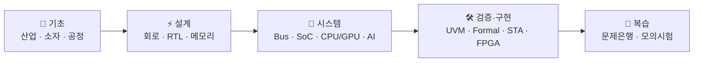

# 📘 ChipBook

**그림과 실습으로 배우는 반도체 설계 가이드북.**

### [🌐 바로 보기](https://bujh99.github.io/ChipBook/)

📚 **28장 · 208절** · 🖱️ **도식·3D·계산 실습** · 📝 **문제은행·모의시험**

## 🗺️ 담긴 내용

| CH | 핵심 내용 |
| :---: | --- |
| 01 | 🏭 반도체 산업·제품·가치사슬 |
| 02 | 🗺️ 설계부터 제품화까지의 흐름 |
| 03 | ⚡ 디지털 논리·RTL·FSM |
| 04 | 📐 Floorplan·배치배선·Signoff |
| 05 | 💾 SRAM·DRAM·NAND·SSD |
| 06 | 🤝 설계 직무·역할·협업 |
| 07 | 🔎 SystemVerilog·UVM 검증 |
| 08 | 🔗 On-Chip Bus·APB·AHB·AXI |
| 09 | 🔌 UART·SPI·I2C·DDR·PCIe |
| 10 | 🧩 SoC 통합·DMA·인터럽트 |
| 11 | 🤖 AI 가속기·MAC·Systolic Array |
| 12 | 🔬 반도체 소자·제조 공정 |
| 13 | 🧱 CMOS 회로·Custom Layout |
| 14 | 📡 Analog·ADC/DAC·PLL·RF |
| 15 | 🧠 CPU·GPU·DSP 구조 |
| 16 | ⚙️ 논리 합성·라이브러리·제약 |
| 17 | ⏱️ STA·Clock·Reset |
| 18 | 🔀 CDC·RDC·동기화 |
| 19 | 🔋 저전력 설계·UPF |
| 20 | 🧪 DFT·Scan·BIST·생산 테스트 |
| 21 | ✅ Formal·SVA·속성 검증 |
| 22 | 📦 패키징·Chiplet·HBM |
| 23 | 🚀 실리콘 Bring-up·수율·신뢰성 |
| 24 | 🛡️ 하드웨어 보안·기능 안전 |
| 25 | 🛠️ EDA·자동화·FPGA |
| 26 | 🏗️ RTL·SoC·NPU 설계 프로젝트 |
| 27 | 📚 문제은행·해설·오답 복습 |
| 28 | 📝 모의시험·채점·설계 리뷰 |

## 🧭 사용법

1. **찾기** — 목차나 검색으로 원하는 주제를 선택합니다.
2. **익히기** — 그림·파형·3D를 살펴보고, 입력값을 바꾸며 동작을 확인합니다.
3. **복습하기** — 문제은행·모의시험을 풀고, 학습 완료와 복습 북마크를 기록합니다.

📦 **설계 예제:** [26장 마지막 절](https://bujh99.github.io/ChipBook/?chapter=26&section=section-06)에서 ZIP 다운로드.

💻 **로컬 사용:** 저장소를 내려받고 [`index.html`](index.html)을 브라우저에서 열면 됩니다.
